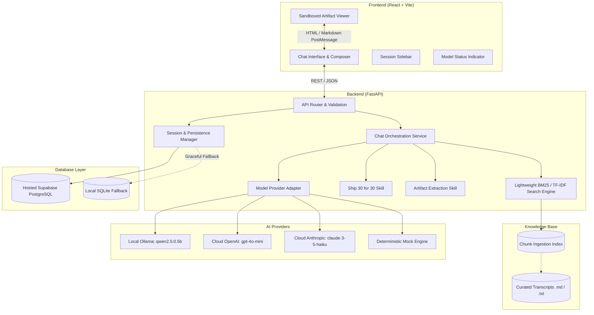

# System Architecture: The Lenny Growth Assistant

## 1. High-Level Architecture Overview



---

## 2. Component Design & Resource Constraints

### 2.1 Hardware Constraints Optimization
- **Memory Footprint Goal**: Total backend memory < 150 MB; frontend build < 30 MB.
- **Pure Python Retrieval**: Uses a zero-bloat BM25 / TF-IDF implementation with vocabulary caps (`max_features=5000`) and sparse array math. Zero PyTorch, zero CUDA, zero sentence-transformers.
- **Bounded Requests**: Context window capped at 4,000 characters; Top-K chunks capped at 4; response tokens capped at 1,024.

---

## 3. Database Schema & Persistence Strategy

### 3.1 SQLAlchemy Models / SQL DDL
```sql
-- Conversations Table
CREATE TABLE IF NOT EXISTS sessions (
    id VARCHAR(64) PRIMARY KEY,
    title VARCHAR(255) NOT NULL,
    created_at TIMESTAMP WITH TIME ZONE DEFAULT CURRENT_TIMESTAMP,
    updated_at TIMESTAMP WITH TIME ZONE DEFAULT CURRENT_TIMESTAMP,
    provider_used VARCHAR(50) NOT NULL
);

-- Messages Table
CREATE TABLE IF NOT EXISTS messages (
    id VARCHAR(64) PRIMARY KEY,
    session_id VARCHAR(64) NOT NULL REFERENCES sessions(id) ON DELETE CASCADE,
    role VARCHAR(20) NOT NULL, -- 'user', 'assistant', 'system'
    content TEXT NOT NULL,
    citations_json JSONB, -- Array of source references
    artifact_json JSONB,  -- Extracted artifact payload if any
    created_at TIMESTAMP WITH TIME ZONE DEFAULT CURRENT_TIMESTAMP
);

-- Transcript Chunks Table (Metadata index)
CREATE TABLE IF NOT EXISTS transcript_chunks (
    id VARCHAR(64) PRIMARY KEY,
    source_title VARCHAR(255) NOT NULL,
    guest_name VARCHAR(100) NOT NULL,
    source_url VARCHAR(500),
    chunk_index INT NOT NULL,
    content TEXT NOT NULL,
    word_count INT NOT NULL
);
```

### 3.2 Hybrid PostgreSQL & SQLite Fallback Mechanism
- The application evaluates `DATABASE_URL` upon boot.
- If `DATABASE_URL` starts with `postgresql://` or `postgresql+psycopg2://`, it attempts an active pool ping (`SELECT 1`).
- If unreachable or unset, it initializes SQLite at `./data/lenny_growth.db` and records the fallback state in the health endpoint `/api/health`.

---

## 4. Model Provider Routing Architecture

The `ModelProviderFactory` instantiates providers implementing the unified `BaseModelProvider` interface:

```python
class BaseModelProvider(ABC):
    @abstractmethod
    async def generate_response(
        self,
        messages: List[Dict[str, str]],
        system_prompt: str,
        temperature: float = 0.3,
        max_tokens: int = 1024
    ) -> ProviderResponse:
        pass

    @abstractmethod
    async def health_check(self) -> ProviderHealth:
        pass
```

### Supported Providers:
1. **Local Ollama Provider**: Calls `http://127.0.0.1:11434/api/chat` with configurable model `qwen2.5:0.5b` and 15s timeout.
2. **Cloud OpenAI Provider**: Calls OpenAI REST API `/v1/chat/completions` using lightweight `httpx`.
3. **Cloud Anthropic Provider**: Calls Anthropic REST API `/v1/messages` using lightweight `httpx`.
4. **Deterministic Mock Provider**: Highly tailored, instantaneous mock engine matching real growth questions to provide rich, grounded, verifiable answers for testing and offline environments without spending API credits or needing local RAM.

---

## 5. Knowledge Base Ingestion & Retrieval Pipeline

1. **Ingestion (`app/retrieval/ingest.py`)**:
   - Reads markdown and text transcripts from `data/transcripts/`.
   - Extracts metadata headers (Guest, Topic, URL, Date).
   - Splits content into semantic paragraph chunks (~250–350 words) with 50-word overlap.
   - Computes document frequencies and pre-builds inverted index.
2. **Retrieval (`app/retrieval/indexer.py`)**:
   - Clean tokenization, stopword filtering, and term frequency calculation.
   - BM25 score calculation with dynamic relevance threshold (`score >= 0.15`).
   - If maximum score < threshold, returns empty list with `insufficient_evidence=True`.
3. **Context Assembly**:
   - Injects highest-ranking chunks into system prompt with explicit source tags (`[Source: Episode - Guest]`).
   - Formats citations payload for client-side rendering.

---

## 6. Ship 30 for 30 Skill

The **Ship 30 for 30 Skill** transforms retrieved knowledge into a structured, viral, high-clarity essay:
1. **Hook**: Captures reader attention within 5 seconds.
2. **Core Thesis**: The 1 big lesson / framework.
3. **The 3-4 Core Pillars**: Structured breakdown with skimmable bold headers and bullet points.
4. **Evidence vs. Inference**: Explicit section distinguishing verbatim podcast quotes from strategic deductions.
5. **Actionable Takeaway**: A checklist or exercise the reader can execute today.

---

## 7. Artifact Sandboxing & Security

Untrusted HTML/CSS generated by AI models poses a potential XSS and session hijacking risk. The Lenny Growth Assistant enforces strict boundary isolation:
1. **Iframe Attributes**:
   - `sandbox="allow-scripts"`
   - Strictly Omits: `allow-same-origin`, `allow-top-navigation`, `allow-forms`, `allow-popups`.
2. **Storage Isolation**:
   - Because `allow-same-origin` is omitted, the sandboxed iframe operates on an opaque `null` origin, making it impossible to read `localStorage`, `sessionStorage`, `document.cookie`, or parent window DOM.
3. **Communication**:
   - Purely unidirectional via `srcDoc` property assignment.
4. **Content Security**:
   - Strips dangerous `<meta http-equiv="refresh">` and malicious external script schemes.

---

## 8. API Endpoint Specification

| Endpoint | Method | Description |
| :--- | :--- | :--- |
| `/api/health` | GET | Health & readiness probe, active provider, DB type |
| `/api/sessions` | GET | List all active conversation sessions |
| `/api/sessions` | POST | Create a new session |
| `/api/sessions/{id}` | GET | Get session details & message history |
| `/api/sessions/{id}` | DELETE | Delete session |
| `/api/chat` | POST | Send user message, retrieve context, stream/return response |
| `/api/skills/ship30` | POST | Generate a Ship 30 for 30 essay on a specified topic |
| `/api/skills/artifact`| POST | Explicitly extract or generate an isolated HTML/MD artifact |
| `/api/retrieval/stats`| GET | Knowledge base index stats & indexed sources count |
| `/api/retrieval/search`| POST | Diagnostic endpoint to inspect raw chunk retrieval scores |
